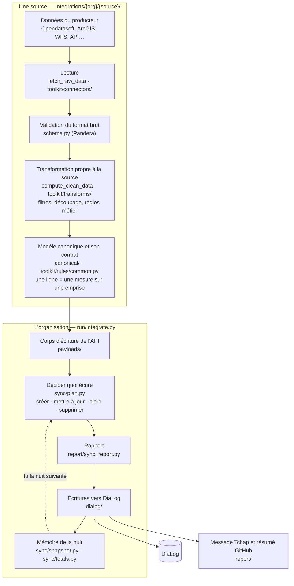
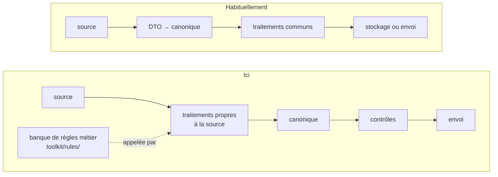

# Architecture : ce que deviennent les données

Ce dépôt lit les arrêtés de circulation que des collectivités publient en open data, les
convertit au format de DiaLog et les envoie à son API. Il n'a pas de base de données : tout
passe par l'API HTTP de DiaLog, et l'état gardé d'une nuit à l'autre tient dans quelques
fichiers (`state/`).

## Le trajet d'une donnée

Chaque nuit, la CI lance une exécution par organisation DiaLog (`co_brest`, `dp_aveyron`…).
Une organisation a une ou plusieurs sources ; chaque source suit le même trajet jusqu'au
modèle canonique, puis toutes les sources de l'organisation sont traitées ensemble.



`--dry-run` s'arrête au rapport : tout est calculé, rien n'est écrit.

## Un modèle canonique tardif

Dans une architecture d'intégration classique, chaque source est traduite **tout de suite**
vers le modèle canonique, par une simple correspondance de champs ; tout le reste du
traitement porte sur ce modèle commun. Ici, le format canonique vient plus tard : les
sources de données sont de natures très variées, et chacune a historiquement été
développée indépendamment des autres.



Ici, chaque source fait l'essentiel de son travail **sur son propre format** : elle filtre,
découpe, applique les règles métier, regroupe par numéro d'arrêté, puis n'arrive au modèle
canonique qu'à la fin. Après lui ne restent que les règles du contrat et l'envoi. Le modèle
canonique est donc surtout le **contrat de sortie** de chaque source : ce qu'elle doit
produire, quelle que soit la façon dont elle y arrive.

Conséquence pour qui lit le code : une règle métier partagée se cherche dans
`toolkit/rules/`. Celles de `toolkit/rules/common.py` valent pour toutes les sources :
les règles communes sauf pour celles qui en désactivent une (`disabled_rules`, avec la
raison), les règles du contrat toujours. Un filtre propre à un producteur se cherche dans sa
source (`integrations/{org}/{source}/data_source_integration.py`). Une règle s'écrit une
fois, et une source l'applique à l'étape de sa transformation qu'elle choisit (voir
[Le modèle canonique et les contrôles](modele-canonique.md#les-règles-métier)).

## Où vit chaque étape

```text
cli.py              la commande `dialog` : integrate, publish, notify
settings.py         la configuration d'une organisation (.env)
registry.py         lit integrations.toml : ce qui tourne chaque nuit, et où
integrations.toml

canonical/          le contrat entre une source et la suite
  regulation_measure.py   les colonnes du modèle canonique
  source.py               le gabarit d'une source : lire → valider → transformer → garder le canonique
payloads/           des lignes canoniques aux corps d'écriture de l'API
  regulations.py    regroupement par arrêté, découpage en tranches
  measures.py       mesure, période, emprise, véhicules
dialog/             parler à DiaLog
  client.py         le client HTTP authentifié
  calls.py          un appel par opération (lire, créer, mettre à jour, supprimer, publier)
  failures.py       refus ou panne, et leurs causes
  zone_flow.py      la création des arrêtés à emprise zone
  zone_sections.py  les mesures de tronçons qu'elle utilise
sync/               décider quoi écrire, se souvenir de ce qui a été envoyé
  plan.py           les lots de la nuit et leurs plafonds
  outcome.py        ce qu'une exécution a fait (CLI, Tchap)
  digest.py         l'empreinte d'un arrêté envoyé
  snapshot.py       l'instantané : les empreintes de la nuit précédente
  totals.py         les volumes d'une nuit à l'autre, et la garde de volume
  closure.py        clore un arrêté sorti de la source
  dating.py         dater un arrêté que la source ne date pas
run/                l'exécution d'une organisation, une étape par fichier
  organization.py   ce que déclare un integration.py, et les points d'entrée
  integrate.py      ce que fait `dialog integrate`, étape par étape
  sources.py        exécuter chaque source, geler celle qui plante ou est en pause
  freeze.py         geler une source dont le volume s'effondre
  writes.py         créer, mettre à jour, clore, supprimer, et compter les échecs
  state.py          ce que la nuit laisse à la suivante : instantané et volumes
  datasets.py       les lignes par jeu de données du message Tchap
report/             ce que lisent les humains
  sync_report.py    le rapport de synchronisation
  notifier.py  summary.py  tchap_bot.py   message Tchap, résumé GitHub
toolkit/            ce qu'une source peut appeler
  connectors/       lire une plateforme : Opendatasoft, ArcGIS, WFS, téléchargement
  transforms/       heures locales, créneaux, périmètre de compétence, troncature des
                    intitulés, période permanente, types de véhicules déduits des
                    seuils, jumeau 5 km/h de l'aire piétonne
  rules/            les règles métier partagées, celles du contrat, et leur application
integrations/       un dossier par organisation DiaLog, rien d'autre
api/                client de l'API DiaLog, généré (non versionné)
tests/
```

Les dossiers `integrations/{org}/` ne contiennent que du code propre à l'organisation ; le
détail d'une source est dans [Ajouter une source](ajouter-une-source.md).

## Pour aller plus loin

* [Le modèle canonique et les contrôles](modele-canonique.md)
* [Synchronisation : créer, mettre à jour, clore, supprimer](synchronisation.md)
* [Configuration : .env, integrations.toml, CI](configuration.md)
* [Ajouter une source](ajouter-une-source.md)
* [Développement : tests et qualité](developpement.md)
